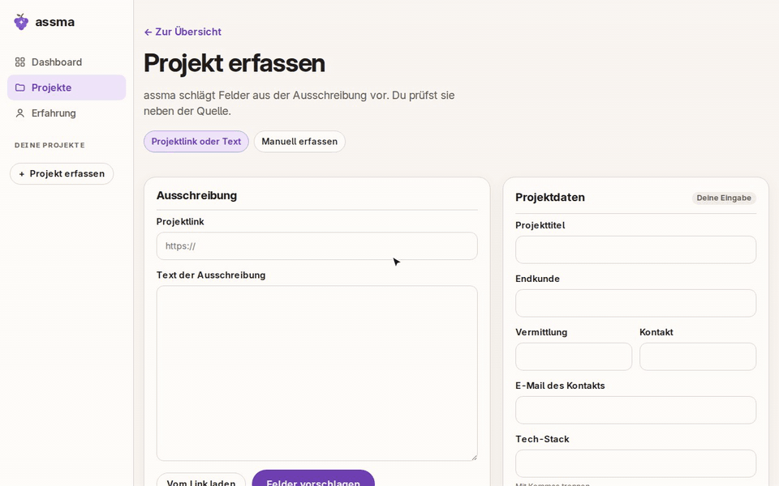

# assma

A local assistant for freelance project acquisition. The design and concept are in
[`docs/`](docs/README.md) ([concept](docs/assma-Concept.md), [brand](docs/brand),
[screens](docs/screens)).

<p align="center">
  
  
</p>

The **landing page** explains the product with an animated demo, the three steps, a tour of
four GIFs recorded in the app (`web/public/tour`: capture, fit, CV design, CV import, each
with a still `.png` for visitors who prefer reduced motion), the privacy points, what comes
next, and a footer with the data-use notice. A link or listing typed into its last field is
carried through sign-up into the project editor (`web/src/lib/seed.ts`).

As in ellma, **data privacy** (`/privacy`), **terms** (`/terms`) and the **imprint**
(`/imprint`) are open to everyone and linked from every footer, together with the cookie
settings (assma only uses necessary browser storage and no tracking). The imprint's operator
details are build settings: set `VITE_LEGAL_NAME`, `VITE_LEGAL_ADDRESS` (lines separated by
`;`), `VITE_LEGAL_EMAIL` and optionally `VITE_LEGAL_REPRESENTATIVE`, `VITE_LEGAL_PHONE`,
`VITE_LEGAL_REGISTER` and `VITE_LEGAL_VAT_ID` in `.env` before building the web image. Until
name, address and email are set, the imprint says the details have not been entered yet.

**Iteration 1** brings the application up on the existing Yappio infrastructure. It
contains the landing page, sign-in and a minimal Dashboard, plus a role-protected admin
shell. assma is registered with Yoster.

**Iteration 2** adds the **Experience** page: personal details (name, role, location,
email, summary) and project references (client, role, period, own contribution,
technologies). They are stored per account in Yappio and later feed the fit assessment and
the tailored CV.

**Iteration 3** adds the **CV import** (`/experience/import`). The browser extracts the text
of a PDF, Word (.docx) or text file (pdf.js and mammoth, loaded on demand), so the file never
leaves the device; pasted text works too. The API queues the text as a background job and
the shared Ollama container (`OLLAMA_MODEL`, default `qwen3.5:4b`, CPU) reads it into
suggestions with a JSON schema. The page polls the job, shows progress and then the source
next to the suggestions. Incomplete entries are flagged for editing, entries matching an
existing reference start unchecked, and personal details only fill empty fields. Nothing is
saved until the person applies the selection.

CVs of up to 100,000 characters are read in parts of about 12,000 characters (split at
paragraph breaks, with a small overlap) and the parts' suggestions are merged, so the prompt
always fits the model context. The page shows the part being read and an estimated duration.
On the shared CPU, reading runs at about 55 tokens/s and writing takes 10–12 seconds per
position: a short CV needs 1–2 minutes, 30,000 characters about 5–10 minutes. Jobs run one at
a time in memory, may take up to 15 minutes per part, are abandoned after 10 minutes without
a poll (browsers slow background tabs to about one request per minute) and expire 30 minutes
after they finish.

**Iteration 4** adds the **project register** (`/projects`): Active and Archive tabs, search
over title, end client and agency, status filters (captured, applied, in review, interview,
closed), a row menu for status, archive and delete, and the newest active projects in the
sidebar. A project is captured (`/projects/new`) from a link or listing text, where the local
model suggests title, end client, agency, contact, tech stack, required and preferred
experience and the working terms (about 30 seconds for a typical listing), or entered
manually. Suggestions only fill empty fields, and the original link and listing text are
kept as the source. Listing suggestions share the model queue with the CV import, so the CPU
runs one model task at a time.

"Load from link" fetches public pages only (`platform/safeFetch.ts`): http and https on
default ports, at most three redirects, 2 MB and 10 seconds, and every connection (each
redirect included) refuses private, loopback, link-local, shared, documentation and
multicast addresses in the socket's own DNS lookup, so a link cannot reach MongoDB, Ollama or
other containers. A schema.org JobPosting on the page is preferred over the page text. Pages
that need a login or JavaScript report that the text should be pasted instead.

**Iteration 5** adds the **experience fit** (`/projects/<id>`) and the **tailored CV**
(`/projects/<id>/cv`). The local model proposes, per required and preferred item, whether a
reference confirms it, partly supports it or nothing does, with the supporting references
(E01, …) and a one-sentence reason (about 30–60 seconds). The score itself is computed by
fixed rules, as in the concept: required items weigh 2 points, preferred 1; confirmed earns
the full weight, partial half, missing nothing; the result is scaled to 1–10 and a project
without requirements stays unscored. Claims without a known reference count as missing. Each
finding can be corrected by hand and the score is recomputed. The assessment stores a
fingerprint of the requirements and references, so the page marks it as out of date after
either changes. "Save and check fit" on the capture page opens the fit and starts the
assessment. The register shows the score.

The tailored CV starts from the profile summary and the references that support the fit,
ordered by weight. The person picks a photo, edits the short profile, chooses the skills of
the matrix and selects and orders references, and saves the draft on the project.

The Experience page holds what a full CV needs: contact details (address, phone, email,
website), languages with their level (native, C2–A1), education, certificates, hobbies and
up to six profile photos. Photos are cropped to a
square JPEG in the browser and stored privately (`AssmaProfileImage`); the CV import also
reads phone, address, website, languages (levels such as "Muttersprache" or "fluent" map to
CEFR), education, certificates and hobbies.

The **skill matrix** is computed from the project references (`shared/src/skills.ts`): years
per technology and per role are the union of the project periods, so overlapping projects
count once, plus the number of projects and the year last used; the total experience is the
union of all periods. Skills the project asks for come first.

Each CV draft has its own **language** (German or English, for headings, dates and units,
independent of the interface) and **design** (`shared/src/cvDesign.ts`): six colour themes
(Aubergine, Ocean, Forest, Graphite, Bordeaux, Sand), five layouts (sidebar left, the
original and default; sidebar right; header band; classic with a skill table and dates on
the left; modern with a two-column skill grid) and five photo frames (circle, rounded,
square, hexagon, double ring). Frames are drawn on a canvas as a transparent PNG, so the
preview and the PDF show the same image.

The preview, the Markdown and the PDF render the same document. The PDF (pdf-lib, generated
in the browser) has a dark sidebar with the round photo, contact, skill matrix with bars,
certificates and hobbies beside the main column with name, role, experience, profile, roles
with years and the project history as a timeline with technology tags; both columns flow
onto further pages, with page numbers. Inter (`inter-font`) is embedded whole with
contextual alternates off: fontkit's subsetting drops Inter glyphs, and the alternates have
other widths than pdf-lib measures. A CV PDF is about 0.6 MB.

Applications (email and portal), statistics and the assistant follow in later iterations.

**Iteration 6** adds **applications** and a working **Dashboard**. From a project's fit page
(or "Apply with this CV" on the CV page), `/projects/<id>/apply` prepares the application:

- **By email:** recipient, subject and a first message in the CV's language (greeting, the
  confirmed requirements as strengths, a signature from the profile). assma builds the CV PDF
  and a ready-to-send **`.eml` draft** with the PDF attached (`X-Unsent: 1`, so Outlook opens
  it as a draft; Thunderbird and Apple Mail open it too). The email leaves from the person's
  own mail app and address; assma stores no mail credentials. A mailto link is the fallback
  for web mail (without attachment; the PDF is downloaded alongside).
- **Through a portal:** portal, submission time, a note, and whether the CV was uploaded. A
  record may state explicitly that no CV was uploaded.

Recording the application (`POST /applications`) **freezes** the listing, the fit, the profile,
the references (selected and all, for the matrix years), the CV choices with the photo, and
keeps the **exact PDF** that was sent (separate sealed collection, up to 3 MB). Later edits
change future drafts only. A captured project moves to "applied". The application page
(`/applications/<id>`) sets the project's status, plans a **follow-up** date with a note, keeps
an **activity** log (notes, replies, status and follow-up changes), and offers the original PDF,
a fresh PDF or Markdown from the frozen copy. Deleting a project deletes its applications.

The **Dashboard** shows follow-ups that are due or overdue, those coming up in the next two
weeks, totals (applications, this month, open, projects interviewing) and recent activity.
Progress (week and month comparison, channels) follows next.

Yappio parses every JSON body first with a 100 kB limit; that parser now steps aside for
`/api/assma/*`, whose routes parse their own bodies after the session check with per-route
limits (64 kB by default, 512 kB for CV text, captures and photos, 4.5 MB for an application
with its PDF). Before, a CV text over about 100 kB was refused despite the 100,000-character
limit.

## Structure

The npm workspaces follow [ellma](https://github.com/AhmetCavus/ellma):

- `shared/`: contracts (zod), EN/DE copy and the `AssmaApi` client over `yappio-client`.
- `server/`: Yappio 1.3.1 bootstrap. `platform/` holds the CORS and platform boundary,
  the session and role gate (`requireAccount`), attempt limits and `yappio.ts` (the only
  file that reaches into Yappio's unexported services). `account/` serves sign-in and the
  signed-in account under `/api/assma/account`. `experience/` serves the signed-in
  person's profile and references under `/api/assma/experience`, and the CV import jobs
  under `/api/assma/experience/import`; every query is scoped to the account.
  `projects/` serves the project register, listing capture, fit assessment and CV draft
  under `/api/assma/projects`.
  `platform/ollama.ts` is the model client, `platform/modelJobs.ts` the shared model queue
  and `platform/safeFetch.ts` the guarded fetch for listing links. `admin/` serves `/api/assma/admin`, for admin and root only. The boundary
  seals the account-security and experience collections from Yappio's generic collection
  API, so not even admins read that content there.
- `web/`: React landing page (grape logo, light and dark theme, language, GitHub link),
  sign-in and sign-up, and the workspace with Dashboard as the first navigation item,
  followed by Experience.
- `admin/`: separate React admin shell. It accepts only admin and root accounts, and
  the API checks the role again on every request.
- `docker/`: Compose stack, Dockerfiles, nginx, the Traefik file route, environment
  setup and infrastructure verification.

## Install

Requires Node.js 22 or later, Docker, the shared `ollama` container on `dev-proxy` with
`qwen3.5:4b` installed (for the CV import), and access to the internal Verdaccio registry
(`http://192.168.178.131:4873/`, set in `.npmrc`). The registry serves `yappio@1.3.1`
and `yappio-client@1.0.1` and proxies the public registry.

```bash
npm install
```

## Configure

```bash
npm run setup:environment
```

The setup:

- reads the shared-mongo administrator from `../infra/mongo/.env.mongo`;
- creates the database user `assma_…` with `readWrite` on the logical database
  `assma` (or verifies the existing one);
- writes `.env` with mode 0600;
- copies `docker/traefik.yml` to `../infra/traefik/dynamic/assma.yml`.

Running it again keeps the existing database credentials, `JWT_SECRET` and initial admin
password. `.env` is ignored by Git. `.env.example` lists every setting with placeholders.

The initial administrator signs in with the address **`admin`**, not
`INITIAL_ADMIN_USER`, and with `INITIAL_ADMIN_PASS` from `.env`. Yappio stores that
account with email `admin` and puts `INITIAL_ADMIN_USER` into its name.

## Run

The containers `assma-web`, `assma-admin` and `assma-api` (port 4100) join the existing
`dev-proxy` network and use `shared-mongo`. The shared Traefik routes them through its
file provider:

| Host                    | Container        |
| ----------------------- | ---------------- |
| `assma.yappai.de`       | `assma-web:80`   |
| `assma-admin.yappai.de` | `assma-admin:80` |
| `assma-api.yappai.de`   | `assma-api:4100` |

Start, stop and restart the stack from Yoster, or run it directly:

```bash
docker compose --env-file .env -f docker/docker-compose.yml up -d --build
```

For local development, run the API on 4100, the web app on 5182 and the admin shell on 5183. ellma uses 4000, 5180 and 5181, so both run side by side:

```bash
npm run dev
```

## Verify

```bash
npm run check                  # types for all workspaces and tests
npm test                       # unit tests (shared and server)
npm run build                  # production builds
npm run verify:infrastructure  # Compose, routing, manifest and Yoster discovery
```

`verify:infrastructure` checks that Compose, `docker/traefik.yml` and
`yappai.host.yaml` agree on:

- the container names, ports and health checks;
- the Yappio management URL;
- the `shared-mongo` database reference.

It then validates Compose with `.env.example` in a temporary hosting root and runs
Yoster's real `HostingManifestDiscoveryService` there. That must yield exactly one
`assma` entry with the services `web`, `admin` and `api`. When `.env` exists, it also
discovers assma from the real hosting root (`YAPPAI_HOST_ROOT`, default `..`). Yoster
needs `.env` as the manifest's `composeEnvFile`. Without it, assma is not listed.

Smoke check on the running stack, through the shared Traefik:

```bash
curl -H 'Host: assma-api.yappai.de' http://127.0.0.1/yappio/health
```

## Yoster registration

`yappai.host.yaml` registers id and slug `assma`:

- **Compose:** `docker/docker-compose.yml` with `.env`.
- **Services:** `web`, `admin` and `api`, with their health checks.
- **Yappio:** management URL `http://assma-api:4100`.
- **Database:** `mongodb` / `assma` on `shared-mongo`.

Yoster scans its hosting root (`/srv/yappai/hosting`) and lists assma once `.env` exists.

The Cloudflare tunnel sends `assma.yappai.de`, `assma-admin.yappai.de` and
`assma-api.yappai.de` to the shared Traefik, as for ellma.
