# assma 🍇

> **Status: Alpha.** assma is a working first version that is still being built step by step. Expect rough edges, breaking changes and data model changes without migration. Not meant for production use yet.

**assma** is a personal assistant for freelancers who look for their next project. You paste a project listing; assma reads it, checks it against your own project experience, explains how well you fit, builds a CV tailored to that one project and keeps track of the application until you get an answer. It runs on an **open-weight model** (Qwen via Ollama) on our own server, so listings and CVs never go to a third-party AI provider.

### Why grapes?

The name comes from _asma_, the Turkish word for the **grapevine**. It is the sibling of [ellma](https://ellma.yappai.de), whose red apple (_kızıl elma_) is the goal on the horizon. assma's fruit grows differently:

- **Your experience is the vine.** Every project you have done is part of it, and it grows a little every year. assma never invents experience; everything it says about you is traced back to a reference on that vine.
- **Every new project is a cluster of grapes.** It starts small and green when you capture a listing, and it ripens as you check the fit, shape the CV and send the application.
- **Grapes are picked when they are ripe.** A good application is not sent to everything at once. assma shows you which projects really fit, where evidence is missing and when it is time to follow up, so you pick the right ones at the right moment.

The grape mark carries the same white four-point star as ellma's apple. On the landing page the grapes fill with colour as you scroll through the steps.

## See it

<p align="center">
  
</p>

<p align="center"><em>Paste a listing. assma reads it and fills in the client, contact, tech stack and requirements.</em><br><sub>All recordings come from the running app with a sample profile (Mara Linden, Android engineer).</sub></p>

**The Dashboard is home.** It shows who to follow up with today, what is coming up, how many applications are open and what happened last.

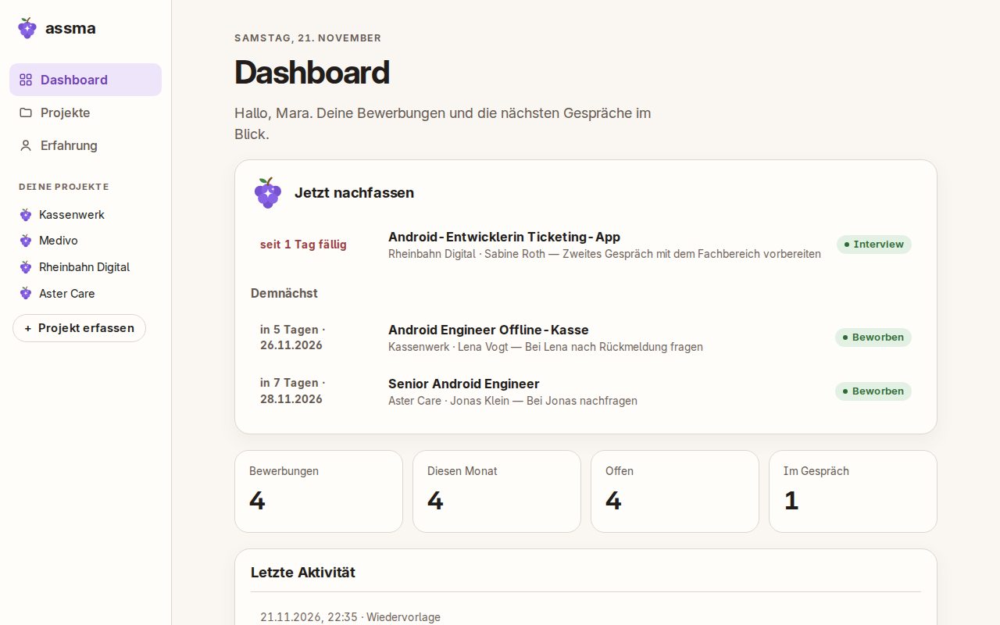

## How it works

**1. Bring your experience.** Drop in your existing CV as PDF or Word file, or paste its text. assma reads it part by part and suggests your profile, project references, languages, education and certificates. You decide what is kept. The file itself never leaves your browser; only its text is read on the server.

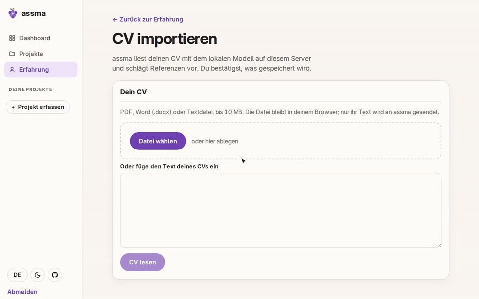

**2. Capture a project.** Paste a link or the listing text. The local model suggests title, end client, agency, contact, tech stack, required and preferred experience and the working terms. It only fills the fields you left empty, and the original listing is kept as the source.

**3. Check the fit.** Every requirement is checked against your references: _confirmed_, _partly supported_ or _missing_, each with the references that back it up and a one-sentence reason. The score from 1 to 10 follows fixed, visible rules (required items count double). If assma got something wrong, change the finding and the score follows.

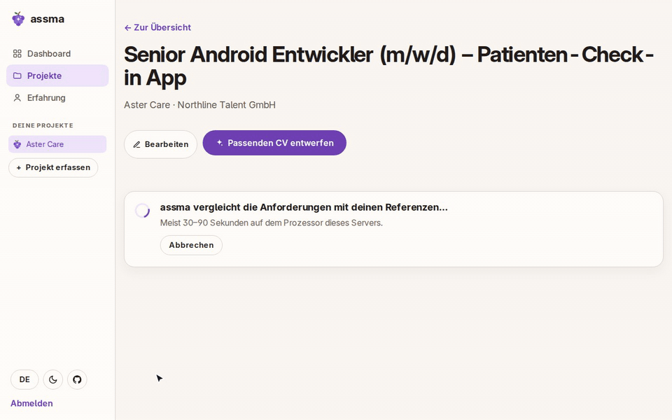

**4. Tailor the CV.** assma starts the CV with the references that support this project, in the order that matters most. You choose the photo, the short profile, the skills and the references. The **skill matrix** counts real years per technology from your project periods (overlapping projects count once). Pick German or English, one of six colour themes, five layouts and five photo frames, then export a PDF or Markdown, built in your browser.

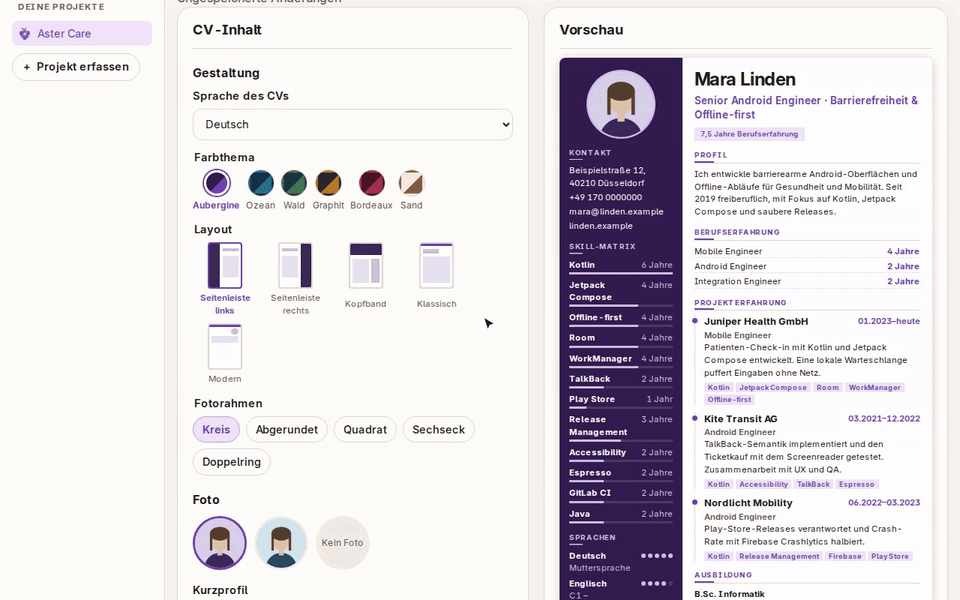

**5. Apply and follow up.** By **email**, assma writes a first message in the CV's language (greeting, your confirmed strengths, your signature) and hands you a ready **`.eml` draft** with the PDF attached. Open it in Outlook, Thunderbird or Apple Mail and send it from your own address. By **portal**, you note where you applied and whether you uploaded the CV. Once recorded, assma **freezes** what you sent: the listing, the fit, your profile, the references and the exact PDF. Later edits never change it. Then you plan the follow-up and log replies and status changes.

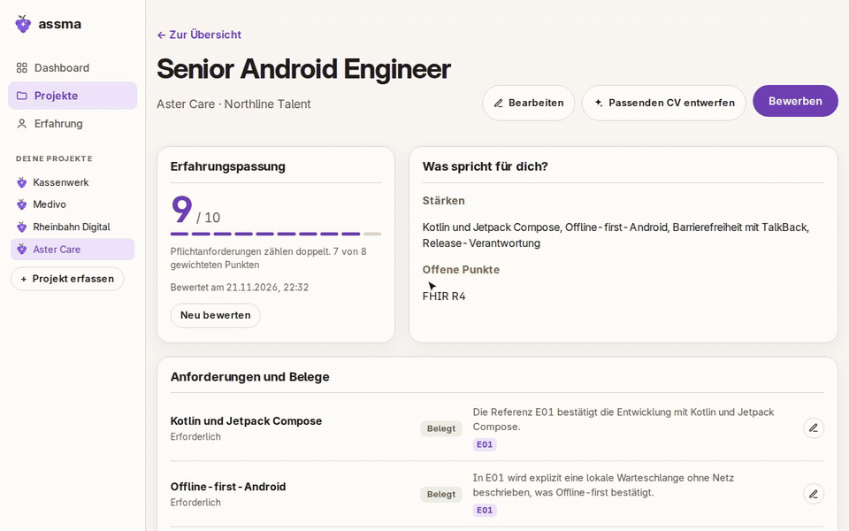

### The pages

| Projects: every listing with status and fit                                                         | A project: the fit, requirement by requirement                                                 |
| --------------------------------------------------------------------------------------------------- | ---------------------------------------------------------------------------------------------- |
| 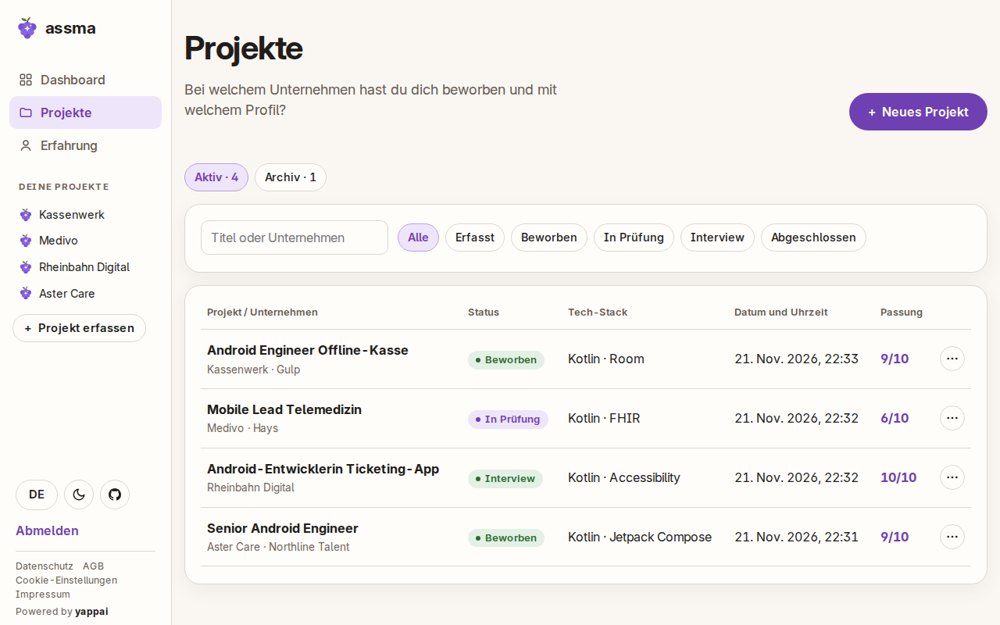              | 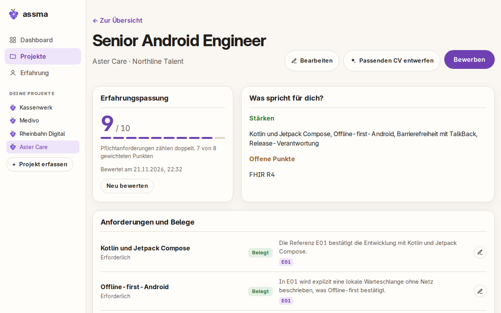 |
| **The CV: content, design and live preview**                                                        | **An application: status, follow-up and what was sent**                                        |
| 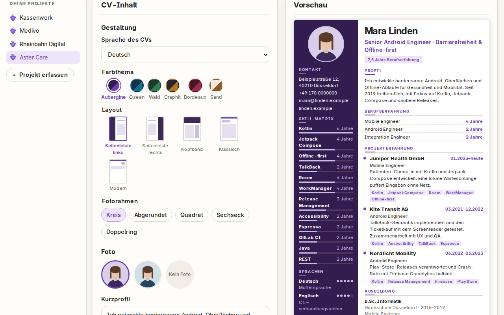      | 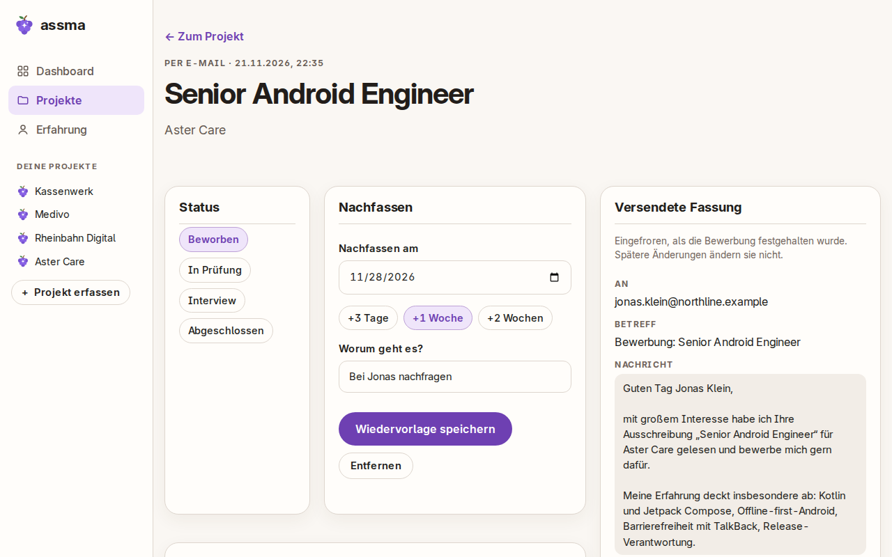 |
| **Apply: the email, ready to send**                                                                 | **Experience: your profile and project references**                                            |
|  | 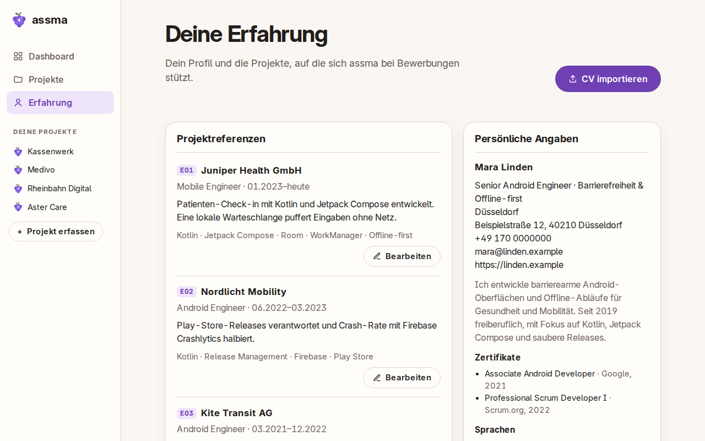       |

<p align="center"><em>On a phone:</em></p>

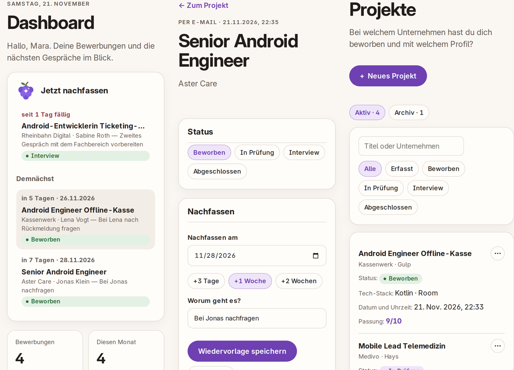

<p align="center"><em>In English, and in the dark:</em></p>

| 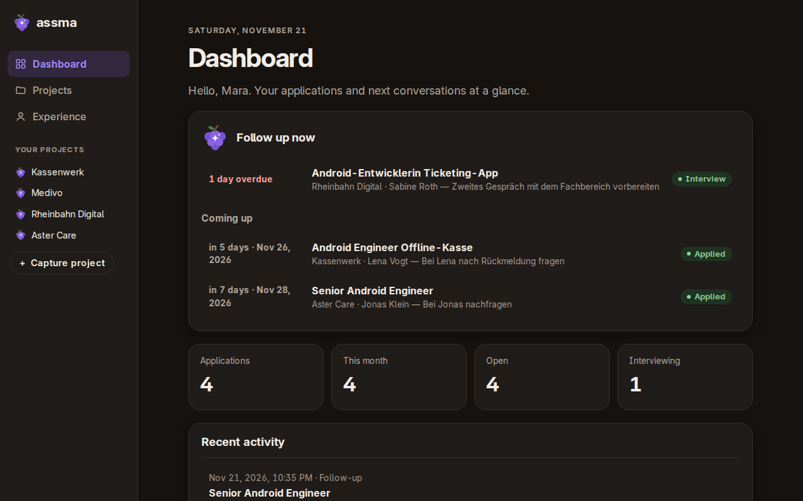 | 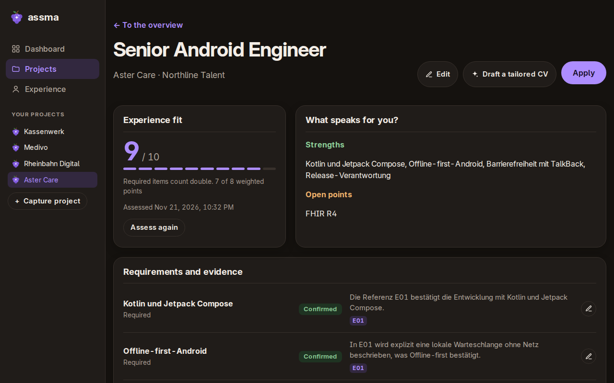 |
| -------------------------------------------------------------------------- | ------------------------------------------------------------------- |

The landing page ([assma.yappai.de](https://assma.yappai.de)) has a scripted live demo, a tour of four recordings (`web/public/tour`, each with a still `.png` for visitors who prefer reduced motion) and a field where you can paste your first listing; it is carried through sign-up into the project editor.

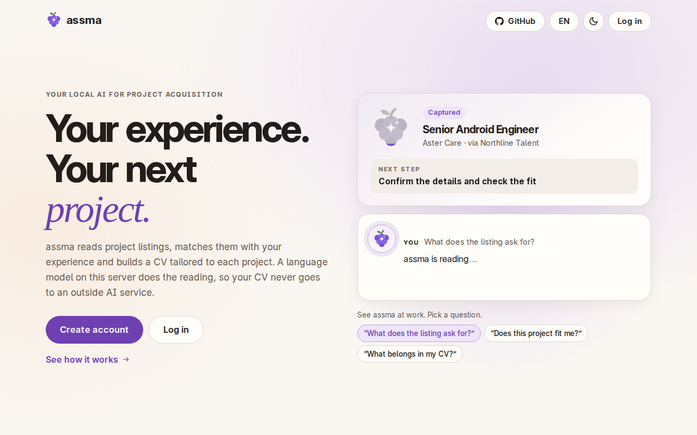

## Background

Finding freelance projects is repetitive work: read a listing, decide whether it fits, pick the right projects from your history, adjust the CV, write the email, remember to follow up. assma does the reading and the bookkeeping and leaves the decisions to you. Nothing is sent on your behalf.

Like ellma, assma is also a test project for two things under real conditions:

- **The yappai infrastructure**: building on [Yappio](#built-on-yappio), hosting through [Yoster](#host-with-yoster), routing via Traefik, and sharing services (`shared-mongo`, `ollama`) between apps.
- **Open-weight models in local operation**: reading listings and CVs and assessing the fit with a small model on our own CPU-only hardware, and finding out how far that gets compared to hosted models.

The original design and concept are in [`docs/`](docs/README.md) ([concept](docs/assma-Concept.md), [interactive design](docs/assma-Landingpage.html), [brand](docs/brand)).

## What it does

| Area             | Features                                                                                                                                                                                                                                                                                                |
| ---------------- | ------------------------------------------------------------------------------------------------------------------------------------------------------------------------------------------------------------------------------------------------------------------------------------------------------- |
| **Dashboard**    | Follow-ups due today or overdue, those in the next two weeks, totals (applications, this month, open, in interview) and the latest activity.                                                                                                                                                            |
| **Experience**   | Profile with contact details, summary, languages (native, C2–A1), education, certificates, hobbies and up to six photos. Project references with client, role, period, your own contribution and technologies. CV import from PDF, Word or text, read in parts so even long CVs fit the model.          |
| **Projects**     | Active and archive tabs, search, status filters (captured, applied, in review, interview, closed). Capture from a link (public pages only) or pasted text, or enter by hand. Your newest projects stay in the sidebar.                                                                                  |
| **Fit**          | One finding per requirement with its evidence and reason, a score from fixed rules, manual corrections, and a hint when the listing or your references changed since the last check.                                                                                                                    |
| **Tailored CV**  | References chosen and ordered by fit, a skill matrix in years, CV language independent of the interface, six themes, five layouts, five photo frames. Preview, PDF and Markdown show the same document.                                                                                                 |
| **Applications** | Email (`.eml` draft with the PDF attached, or a mailto link for web mail) or portal. A frozen copy of everything that was sent, including the original PDF. Status, follow-up date with a note, and a timeline of notes, replies and changes. A fresh PDF or Markdown from the frozen copy at any time. |
| **Everywhere**   | German and English, light and dark, phone layout, and a footer with privacy notice, terms, cookie settings and imprint.                                                                                                                                                                                 |

**Coming next:** Progress (weeks and months compared, email versus portal, companies, interviews) and an assistant you can ask about your projects.

### Your data

- **A model on this server.** Listings and CVs are read by an open-weight model running next to assma. No outside AI service sees them.
- **Your own installation.** Profile, references, photos, projects and applications live in this installation's database, each account sees only its own data, and these collections are sealed from Yappio's generic API, even for admins.
- **Built in your browser.** CV files you import are turned into text in the browser; PDFs, Markdown and email drafts are created there too.
- **Your own mail app.** assma stores no mail passwords and sends nothing. You send the email yourself.
- **No tracking.** assma sets no cookies; it only keeps what the app needs (sign-in, language, theme) in the browser's storage.

### Accounts, admin and legal pages

- **Sign-in** goes through assma's own endpoint (`/api/assma/account/login`), which limits attempts.
- **Admin panel**: a separate site (`admin/`, `https://assma-admin.yappai.de`) for `admin` and `root` accounts. It shows account totals only, never profiles, projects or applications. The first administrator signs in with the name **`admin`** (not an email address) and `INITIAL_ADMIN_PASS` from `.env`.
- **Legal pages**: privacy (`/privacy`), terms (`/terms`) and imprint (`/imprint`) are open to everyone and linked from every footer. The texts live in `shared/src/locales` (`legal`) in English and German. The operator details come from `VITE_LEGAL_*` in `.env` (see `.env.example`) and are built into the web app; until name, address and email are set, the imprint says the details are missing.

## Built on Yappio

**Yappio** is yappai's own backend framework for Node.js (private npm packages from our Verdaccio registry). It brings accounts with JWT sessions and roles, collections declared in a few lines on top of Mongoose, a health endpoint and an initial admin account, so assma only writes its own domain logic.

assma adds its routes under `/api/assma` (account, experience, projects, applications, admin) and puts a boundary in front of Yappio's generic collection API: only admins reach it, and assma's content collections are sealed there completely. Yappio parses every JSON body with a 100 kB limit; that parser steps aside for `/api/assma/*`, where each route reads its own body after the session check with a fitting limit (64 kB by default, 512 kB for CV text and photos, 4.5 MB for an application with its PDF).

## Stack

- **Yappio** (`yappio@1.3.1`, `yappio-client@1.0.1` from Verdaccio).
- **Server**: Express via Yappio, Mongoose collections on `shared-mongo` / database `assma`.
- **Model**: one provider for the whole API, chosen with `LLM_PROVIDER` (see `.env.example`): a self-hosted model through Ollama (the default, `qwen3.5:4b` on the shared container) or an OpenAI-compatible server such as vLLM, OpenAI, or Claude. Every provider streams JSON constrained to assma's schemas (`server/src/platform/inference`); one model task runs at a time through a shared queue, and every answer is validated again. `docker exec assma-api node dist/scripts/inferenceSmoke.js` checks the configured model.
- **Web**: React 18 + Vite, no UI framework. pdf.js and mammoth read imported CVs, pdf-lib with the embedded Inter font writes the CV PDF.
- **Admin**: a second small React + Vite app (`admin/`) on its own host.
- **Shared**: zod contracts, the EN/DE copy and the typed API client, used by server, web and admin.

The code is split into npm workspaces as in [ellma](https://github.com/AhmetCavus/ellma): `shared/`, `server/`, `web/`, `admin/` and `docker/`.

## Develop

Requires Node.js 22 or later, Docker, the shared `ollama` container with `qwen3.5:4b`, and access to the internal Verdaccio registry (set in `.npmrc`).

```bash
npm install
npm run setup:environment        # or: cp .env.example .env
npm run dev                      # API :4100 + web :5182 + admin :5183
```

The ports differ from ellma's (4000, 5180, 5181), so both run side by side.

Install with `npm ci`, which takes every package exactly as recorded in `package-lock.json` and checks its hash. Do not point `.npmrc` at the public registry to get past a failing install: the Yappio package names are not published there, and a package someone else published under the same name would be installed instead.

## Verify

```bash
npm run check                  # types for all workspaces and tests
npm test                       # unit tests (shared and server)
npm run build                  # production builds
npm run verify:infrastructure  # Compose, routing, manifest and Yoster discovery
```

`verify:infrastructure` checks that Compose, `docker/traefik.yml` and `yappai.host.yaml` agree on container names, ports, health checks and the database, and then runs Yoster's real discovery against the manifest, so a broken manifest shows up before deployment.

## Host with Yoster

**Yoster** (repository `yappai-host`) is yappai's hosting manager. Apps live side by side in one hosting root and share one set of infrastructure: `shared-mongo` (one database and one user per app), `ollama`, Traefik on the `dev-proxy` network and a Cloudflare tunnel for the `*.yappai.de` domains. Yoster finds each app through its `yappai.host.yaml` and starts and stops its Compose stack.

| Host                    | Container        |
| ----------------------- | ---------------- |
| `assma.yappai.de`       | `assma-web:80`   |
| `assma-admin.yappai.de` | `assma-admin:80` |
| `assma-api.yappai.de`   | `assma-api:4100` |

Steps:

1. `npm run setup:environment`: creates the `assma` database user on shared-mongo (or keeps the existing one), writes `.env` (0600) with generated secrets, and installs `infra/traefik/dynamic/assma.yml`. Running it again keeps credentials, `JWT_SECRET` and the admin password.
2. Fill the `VITE_LEGAL_*` operator details in `.env` for the imprint.
3. `npm run verify:infrastructure`, then start **assma** from Yoster, or by hand:

```bash
docker compose --env-file .env -f docker/docker-compose.yml up -d --build
curl -H 'Host: assma-api.yappai.de' http://127.0.0.1/yappio/health   # smoke check
```

Yoster lists assma once `.env` exists.

## Notes

- **Speed**: on this CPU-only host, capturing a listing takes about 30 seconds and a fit check 30–60 seconds. A short CV imports in 1–2 minutes, a long one (30,000 characters) in 5–10 minutes. A CV PDF is about 0.6 MB.
- **One model task at a time**: CV imports, listing captures and fit checks share one queue, so the CPU is never overloaded.
- **Links**: "Load from link" fetches public pages only and refuses private and internal addresses, so a link cannot reach the database or other containers. Pages that need a login or JavaScript ask you to paste the text instead.
- **Registration is open**. Sign-in attempts are limited in the API; registration is not, so consider rate limiting at Traefik before going public.

## Self-hosting

The code is open, but **assma cannot yet be built outside yappai**: it depends on Yappio, which stays private and is only served by our internal registry. You are welcome to read, review and learn from the code, and to report problems.

If you run a copy for other people, you are the operator of that copy:

- Enter your own operator details (`VITE_LEGAL_*`) and review the privacy notice and the terms in `shared/src/locales` (`legal`); they describe yappai's installation.
- Point `VITE_SOURCE_URL` to the published source of your copy. The footer links to it as required by the AGPL.
- Give your copy its own name and do not present it as the yappai installation at `assma.yappai.de`.

## Security

Please report vulnerabilities privately as described in [SECURITY.md](SECURITY.md), not as a public issue.

## License

assma is free software under the [GNU Affero General Public License v3.0](LICENSE) (`AGPL-3.0-only`). You may use, study, change and share it. If you change assma and let others use it over a network, you must offer them the source code of your changed version under the same license.

Bundled third-party parts keep their own licenses, among them Inter (SIL Open Font License), pdf.js (Apache 2.0), pdf-lib (MIT) and mammoth (BSD-2-Clause). Yappio is not part of this repository and is not covered by this license; [NOTICE](NOTICE) grants the additional permission to combine assma with it.
